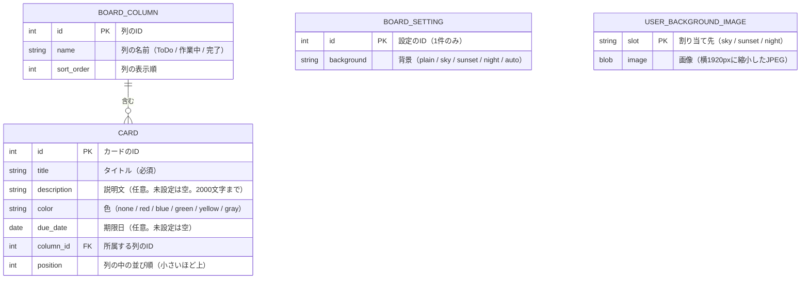

# データ設計

アプリが保存するデータの構造を定める。
1〜3は、データベースの種類に依らない概念レベルの設計。実際の型や名前は、4の「実装での具体化」に記す（[技術スタック](tech-stack.md) を参照）。

## 1. ER図



列・カードと、背景の設定・自分の画像は、互いに関連しない（独立したデータ）。

## 2. データの説明

### 2.1 列（BOARD_COLUMN）
- 現時点では、ToDo / 作業中 / 完了 の3つに固定する
- 将来、「確認待ち」列を追加できるよう、列をデータとして保持する

### 2.2 カード（CARD）
| 項目 | 内容 | 必須 | 関連する要件 |
|---|---|---|---|
| title | カードのタイトル（255文字まで） | 必須 | カードの追加・タイトルの修正 |
| description | カードの説明文（2000文字まで）。未設定の場合は空 | 任意 | 説明文の入力・修正、説明文ありの目印の表示 |
| color | カードの背景色。初期値は none（色なし） | 必須 | 色の変更 |
| due_date | 期限日。未設定の場合は空 | 任意 | 期限日の設定、期限順の並び替え、期限切れの赤文字表示 |
| column_id | カードが入っている列 | 必須 | 列の間の移動 |
| position | 列の中での並び順 | 必須 | 同じ列の中での並び替え、並び順の保存 |

### 2.3 背景の設定（BOARD_SETTING）
| 項目 | 内容 | 必須 | 関連する要件 |
|---|---|---|---|
| background | 選んだ背景（plain：無地、sky：青空、sunset：夕焼け、night：星空、auto：自動） | 必須 | 背景の選択、自動（時間帯） |

- 設定は、1件だけ持つ（実装：表 `board_setting`。id はいつも 1。起動したときに、なければ作る）
- 初期値は sky（青空）。初めて開いたときは、青空の背景で表示する（無地は、選べる選択肢として残す）
- API：`GET /api/settings`、`PUT /api/settings`（本文 `{"background":"night"}`。値が違えば400）

### 2.4 自分の背景画像（USER_BACKGROUND_IMAGE）
| 項目 | 内容 | 必須 | 関連する要件 |
|---|---|---|---|
| slot | 画像の割り当て先（sky / sunset / night）。割り当て先ごとに、最大1枚 | 必須 | 自分の画像の登録 |
| image | 画像のデータ。登録するとき、横1920ピクセルに縮小したJPEGにする | 必須 | 自分の画像の登録、元に戻す |

- 登録していない割り当て先には、データを持たない（標準の画像で表示する）
- 「元に戻す」を行うと、その割り当て先のデータを削除する

## 3. データに関する決めごと
- 新しいカードは、その列の一番上に入る（position が最も小さくなる）
- カードを動かしたとき、動かした先の列の並び順を更新する
- 期限順に並び替えたときは、その結果を position に反映して保存する
- 期限日のないカードは、期限順で末尾に並べる
- 期限切れの判定は、表示のときに「期限日が今日より前で、完了列以外」かどうかで行う（データには持たない）
- バックアップファイルには、列とカードの全項目と、背景の設定を含める。自分の背景画像は含めない
- バックアップを読み込んでも、登録済みの自分の背景画像は変更しない
- 背景の設定がないバックアップを読み込んだときは、背景の設定を sky（青空、初期値）にする

## 4. 実装での具体化（PostgreSQL、2026-10-13）
バックエンドの Entity から、次のテーブルが作られる（列とカードのみ。背景の設定・自分の背景画像は未実装）。

| テーブル | 列 | 型 |
|---|---|---|
| board_column | id（主キー、自動採番） | bigint |
| | name | varchar(255)、必須 |
| | sort_order | integer、必須 |
| card | id（主キー、自動採番） | bigint |
| | title | varchar(255)、必須 |
| | description | varchar(2000)、任意 |
| | color | varchar(255)、必須（none / red / blue / green / yellow / gray。APIで検査する） |
| | due_date | date、任意 |
| | column_id（board_column.id への外部キー） | bigint、必須 |
| | position | integer、必須 |

- 新しいカードの position は、「その列の最小値 − 1」（列が空なら 0）。そのため、負の値になることがある
- **position の方式（2026-10-16 決定）**：カードを動かしたとき（移動API）は、サーバーが、動かす前の列と動かした先の列の position を、**0,1,2,… の連番に振り直す**。画面は、移動先の列と、列の中の位置（0が一番上）だけを送る。連番に直るので、負の値は、その列を動かしたときに消える
- 列の最初の3件（ToDo / 作業中 / 完了）は、バックエンドの起動時に、列が1つもなければ入れる

### バックアップファイルの形式（2026-10-16 決定）
`GET /api/backup` が返し、`POST /api/backup/restore` が受け取る、JSONの形（version 1）。

```json
{
  "app": "taskboard",
  "version": 1,
  "exportedAt": "2026-10-16T12:34:56Z",
  "columns": [
    { "name": "ToDo", "cards": [
        { "title": "牛乳を買う", "description": "2パック", "color": "none", "dueDate": "2026-10-20" } ] },
    { "name": "作業中", "cards": [] },
    { "name": "完了", "cards": [] }
  ]
}
```
- `app` と `version` は、「このアプリのバックアップか」を見分ける目印。違うファイルは読み込まない
- **並び順は、配列の順で表す**（列は左から、カードは上から）。DBのIDと `position` の数値は入れない。読み込むと、IDは振り直され、`position` は 0,1,2,… の連番になる
- カードは、列の中に入れ子で持つ（存在しない列を指す、のような食い違いが起きない）
- 読み込みは、今のカードと列を全部消して入れ替える。1つのトランザクションで行い、検査に失敗したら、今のデータは変わらない
- 背景の設定は `settings`（`{"background":"night"}`）として入る（2026-10-16 追加。形式は version 1 のまま）。`settings` は**省略できる**：ないファイル（古いバックアップ）を読み込むと、背景は初期値の青空（sky）になる。値は plain / sky / sunset / night / auto のどれか（違えば400）。自分の背景画像は含めない。読み込んでも、登録済みの自分の画像には触らない
- 知らない項目は、無視して読める

```json
{ "app": "taskboard", "version": 1, "exportedAt": "…", "settings": { "background": "sky" }, "columns": [ … ] }
```

## 5. 今後確認する事項
- 列の追加・名前の変更を、将来どこまで許すか
- 自分の背景画像の保存方法（ファイルとして保存するか、データベースに入れるか）。プロトタイプでは、ブラウザの中（IndexedDB）に保存している。本番では、技術スタックの決定後に検討する
